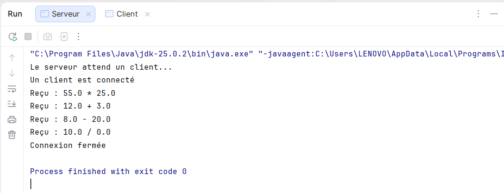
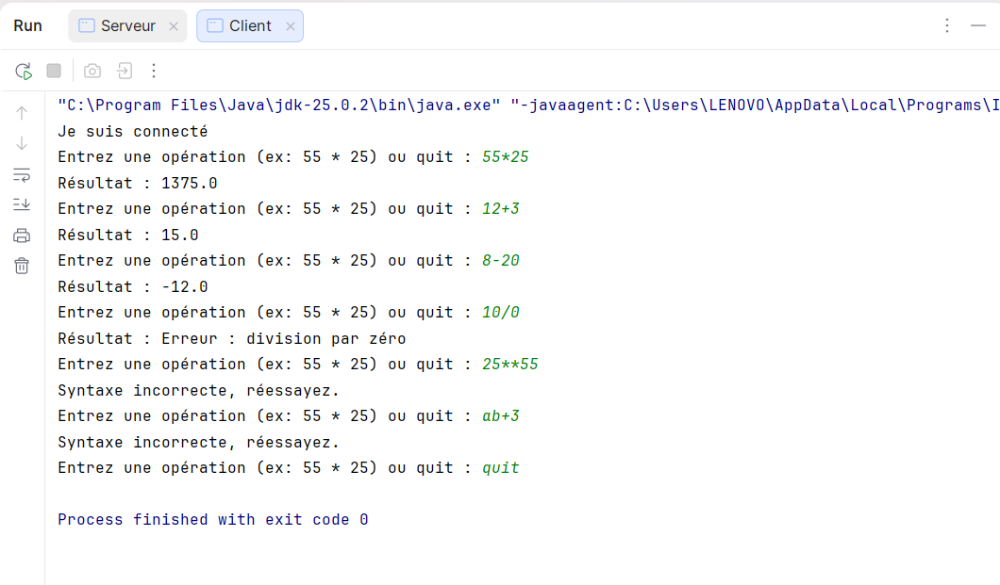
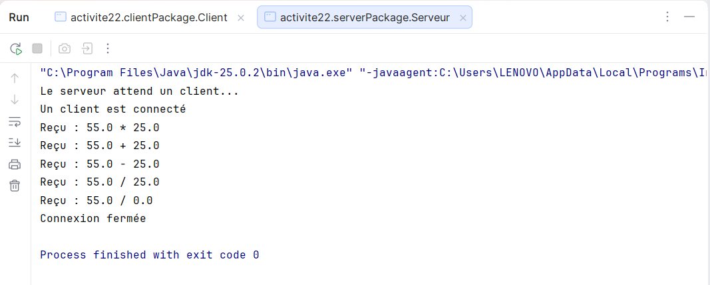
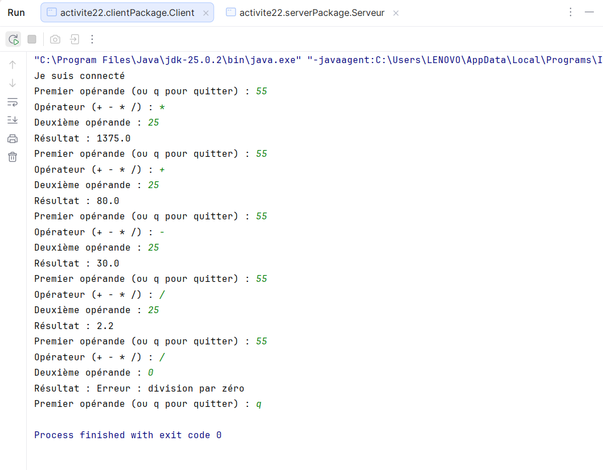

# TP2-DAR2026 - Sockets TCP : échange de chaînes et d'objets

Nom Prénom - LSI3

## Activité 2-1 : Échange de chaînes de caractères

Code source : [src/activite21](src/activite21)

Le client saisit une opération complète (par exemple 55 * 25). Avant l'envoi, la syntaxe est vérifiée avec une expression régulière pour refuser les saisies incorrectes comme 25 ** 55 ou abc + 3. Le client envoie ensuite le premier opérande, l'opérateur et le deuxième opérande avec un PrintWriter. Le serveur les lit avec un BufferedReader, calcule le résultat et le renvoie au client qui l'affiche.

### Serveur

### Client

## Activité 2-2 : Échange d'objets

Code source : [src/activite22](src/activite22)

J'ai créé la classe Operation qui implémente Serializable. Elle contient le premier opérande, l'opérateur et le deuxième opérande. Le client envoie un objet Operation avec ObjectOutputStream. Le serveur le reçoit avec ObjectInputStream, récupère les données, effectue le calcul puis renvoie le résultat au client.

### Serveur

### Client
